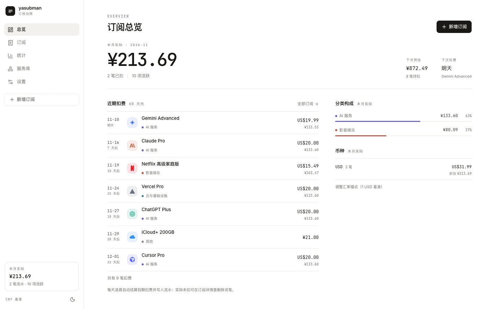
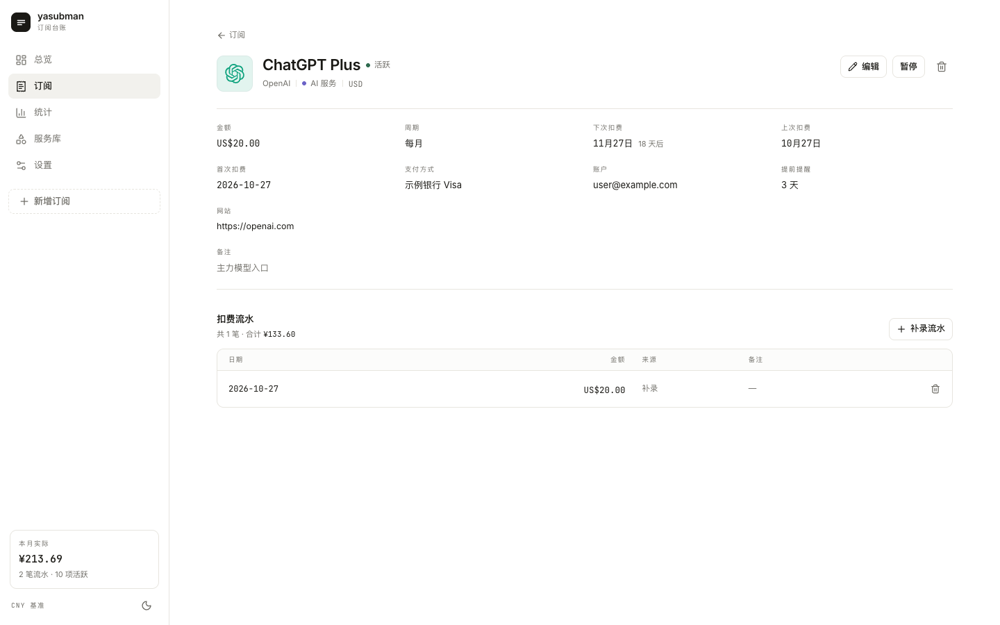
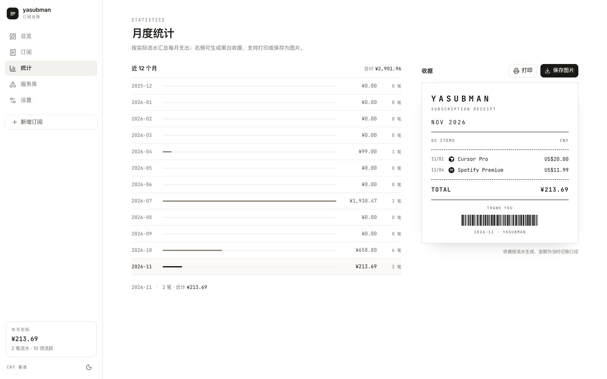

# yasubman · 订阅台账

yet another subscription manager。自托管的订阅管理与支出统计。

自托管的订阅管理应用：维护每一项周期性支出，每天自动结算成真实流水，按「本月实际 / 下月预估」统计。汇率每日自动同步，服务图标可从 App Store 搜索导入，支持 CSV / JSON 导出。

[](https://github.com/HaiFongPan/yasubman/actions/workflows/ci.yml)
[](https://github.com/HaiFongPan/yasubman/actions/workflows/docker.yml)
[](LICENSE)
[](https://yasubman-demo.leopan-me.workers.dev/)

**在线 demo**：https://yasubman-demo.leopan-me.workers.dev/ （只读快照，不需要部署）

## 截图



| 订阅详情与流水 | 月度统计与收据 |
| --- | --- |
|  |  |

- 运行环境：Node.js 24 LTS（最低 22.12；Docker 镜像同为 Node 24）
- 前端：Vite + React 19 + TypeScript + Tailwind CSS v4 + Radix（shadcn 风格组件）
- 后端：Express 5 + better-sqlite3（单文件数据库）
- 部署：单容器 Docker，数据挂载 `/data`，通过 Tailscale 内网访问

## 功能

| 模块 | 能力 |
| --- | --- |
| 总览 | 本月实际支出、下月预估、下次扣费、60 天扣费时间线、分类构成、币种敞口 |
| 订阅 | 增删改查、搜索、按状态 / 分类筛选、排序、暂停 / 恢复；点击进入详情页 |
| 流水 | 每天 00:05 自动把到期订阅结算成流水；详情页可补录历史、删除流水；改价只影响未来 |
| 统计 | 近 12 个月实际支出柱状图；按月生成黑白收据，可打印（只打印收据）或保存为 PNG |
| 服务库 | 91 个内置服务（AI、云、影音、效率、开发者），品牌图标；自定义服务可选品牌图形、字母标记或 **App Store 图标搜索** |
| 分类 | 6 个内置分类 + 自定义分类（名称、颜色）；删除时关联订阅/服务可转移到「其他」 |
| 设置 | 基准币种、13 种币种汇率（每日自动同步，可手动刷新）、CSV / JSON 导出、清空数据 |
| 响应式 | ≥1280 侧边栏 + 表格；768–1279 图标栏 + 卡片；<768 底部导航 + 卡片 |
| App Store | 按关键词搜索 iOS App，一键填入名称、分类、图标、商店链接；服务库可直接导入；新增订阅的「服务 / 名称」输入框会同时列出服务库与 App Store 结果，选中 App 时保存会自动写入服务库（已存在则复用） |
| 主题 | 浅色 / 深色，首次访问跟随系统 |
| MCP | 内置 Streamable HTTP MCP 端点 `/mcp`，Agent 可查询、新增、修改、暂停、删除订阅与服务 |

金额在数据库中以最小货币单位整数存储（如 `2000` = US$20.00），JPY / KRW 等零小数位币种按 `currencies.exponent` 处理，导出与统计不丢精度。每笔流水还固化当时汇率与折合金额，历史不会被后来的汇率或改价改写。

**汇率**：以 1 USD 为锚点，启动时若超过 24 小时会自动同步，之后每 6 小时检查一次；同步失败保留上一次结果，不影响使用。默认使用 [ExchangeRate-API 开放端点](https://www.exchangerate-api.com)（无需 Key、166 种币种、每日更新），不可用时自动降级到 [Frankfurter](https://frankfurter.dev)（欧洲央行数据）。

## 本地开发

```bash
npm install
npm run dev          # 前端 http://localhost:5173，API http://localhost:3001
```

首次启动会在 `data/yasubman.db` 建库，写入币种、内置服务目录和 10 条示例订阅。示例数据可以在界面上逐条删除，或在「设置 → 危险操作」中清空。

```bash
npm run build        # 类型检查 + 前端构建 + 服务端 bundle
npm start            # 生产模式，默认 http://localhost:3000
npm run typecheck
```

## 部署到 Ubuntu（Docker）

```bash
git clone https://github.com/HaiFongPan/yasubman.git yasubman && cd yasubman
docker compose pull
docker compose up -d
docker compose logs -f
```

默认拉取 GHCR 上对应架构的镜像（amd64/arm64）；想用本地源码构建就 `docker compose up -d --build`。不克隆仓库也可以直接跑：

```bash
docker run -d --name yasubman --restart unless-stopped \
  -p 127.0.0.1:3000:3000 -v yasubman-data:/data -e TZ=Asia/Shanghai \
  ghcr.io/haifongpan/yasubman:latest
```

默认只监听 `127.0.0.1:3000`，不直接暴露到公网。数据保存在命名卷 `yasubman-data`。

需要的环境变量（都有默认值，通常不用配）：

| 变量 | 默认 | 说明 |
| --- | --- | --- |
| `FX_PROVIDER` | `auto` | `auto` / `open-er-api` / `frankfurter` / `off`（关闭自动同步，保留现有汇率） |
| `APP_USER` / `APP_PASSWORD` | 空 | **同时**设置后启用 HTTP 基础认证（未设置 = 无认证） |
| `SQLITE_PATH` | `data/yasubman.db` | 容器内为 `/data/yasubman.db` |
| `NODE_ENV` | 未设置 | `production` 时默认端口 3000；`npm start` 已自动设置 |
| `PORT` / `HOST` | 3000（生产）/ 3001（开发），`0.0.0.0` | 监听端口与地址 |
| `CLIENT_DIR` | `dist` | 前端构建产物目录，存在即托管静态页面 |


```bash
docker compose exec yasubman ls -l /data          # yasubman.db / -wal / -shm
docker run --rm -v yasubman-data:/data -v $PWD:/backup alpine \
  tar czf /backup/yasubman-$(date +%F).tar.gz -C /data .
```

如果想用宿主机目录方便备份，把 compose 中的卷改成 `./data:/data`，并先执行：

```bash
mkdir -p data && sudo chown -R 1000:1000 data
```

容器内以 `node`（uid 1000）运行，`/data` 必须可写。

### 通过 Tailscale 暴露

推荐 `tailscale serve`：自动签发证书，只在 tailnet 内可访问。

```bash
sudo tailscale serve --bg 3000        # https://<host>.<tailnet>.ts.net
tailscale serve status
```

或者直接绑定 tailnet IP（不启用 HTTPS）：

```yaml
ports:
  - "100.x.y.z:3000:3000"
```

`tailscale funnel` 会把服务公开到公网，本应用没有内置账号体系，不建议开启；如果确实需要，设置环境变量启用基础认证：

```yaml
environment:
  - APP_USER=alice
  - APP_PASSWORD=一串足够长的密码
```

`/api/health` 不受认证保护，用于容器健康检查。

## 只读 demo（Cloudflare Workers，免费）

线上示例：**https://yasubman-demo.leopan-me.workers.dev/**

想给别人看界面又不想暴露自己的数据，可以部署一份不含任何存储的演示版：静态前端 + 一个把 API 换成构建时快照的 Worker。静态资源请求不消耗额度，`/api/*` 才走 Worker。

```bash
npm run demo:snapshot   # 生成 demo/snapshot.json（脱敏示例数据 + 12 个月历史流水）
npm run demo:deploy     # 构建前端 + wrangler deploy
```

`wrangler.jsonc` 已经配好：`assets.directory = ./dist`、`not_found_handling = single-page-application`（SPA 兜底）、`run_worker_first = ["/api/*"]`（只有 API 进 Worker）。

### Git 集成（push 即更新）

Cloudflare Dashboard → **Workers & Pages** → **Create** → 连接 Git 仓库，选 `HaiFongPan/yasubman`：

| 配置项 | 值 |
| --- | --- |
| Build command | `npm run build:web` |
| Deploy command | 保持默认 `npx wrangler deploy` |
| Root directory | 留空 |

项目名与 `wrangler.jsonc` 里的 `name` 一致（默认 `yasubman-demo`），部署后域名形如 `https://yasubman-demo.<你的子域>.workers.dev`；当前示例为 `https://yasubman-demo.leopan-me.workers.dev/`。

`demo/snapshot.json` 已提交仓库，构建时不需要生成快照，也就不需要 better-sqlite3 的原生编译。若 `npm ci` 因它的 `node-gyp rebuild` 失败，加环境变量 `NPM_FLAGS` = `--ignore-scripts`。

### 演示版的边界

| 能力 | 演示版 |
| --- | --- |
| 浏览总览 / 订阅 / 统计 / 收据 / 服务库 | 可用（数据为只读快照） |
| CSV / JSON 导出 | 可用（预生成的快照） |
| 新增 / 修改 / 删除 | **403**，前端弹「演示模式：数据只读」 |
| App Store 实时搜索 | 不可用（需要联网搜索） |
| MCP 端点 | 无 |
| 汇率同步 | 不可用（快照内置固定汇率） |

演示数据来自 `server/db.ts` 的脱敏种子（`user@example.com` / 示例银行），每次 `npm run demo:snapshot` 重建；改了种子记得重新生成并提交 `demo/snapshot.json`。

## 数据结构

```sql
categories(id PK, slug UNIQUE, label UNIQUE, color, sort, is_builtin, created_at)
                   -- 订阅/服务通过 category = slug 引用；内置分类由种子维护
currencies(code PK, name, symbol, exponent, units_per_usd, sort)   -- 汇率每日由 API 覆盖
service_catalog(id PK, name, slug UNIQUE, category, icon_kind, icon_data, color, website, is_builtin, created_at, updated_at)
                   -- icon_kind: brand(SVG path) | initials(字母) | image(图片 URL)
subscriptions(
  id PK, name, service_id FK → service_catalog ON DELETE SET NULL,
  category, amount_minor INTEGER, currency FK → currencies,
  cycle, cycle_days, anchor_date, status, next_due, paused_at, auto_renew,
  payment_method, account_label, website, notes, remind_days,
  created_at, updated_at
)
payments(id PK, subscription_id FK ON DELETE CASCADE, paid_on, amount_minor,
         currency FK → currencies, rate_units_per_usd, base_minor, base_currency,
         source auto|manual|backfill, note, created_at)
         -- 唯一索引 (subscription_id, paid_on)，重复结算不会重复记账
settings(key PK, value)   -- base_currency / demo_seeded / ledger_ready_v3 / rates_*
-- 索引：idx_subscriptions_status / idx_subscriptions_service / idx_payments_sub
```

- `rates_*` 设置项记录同步来源、时间、下次更新时间与失败原因，设置页据此展示状态
- `cycle`：`weekly | biweekly | monthly | quarterly | semiannual | yearly | custom`
- `status`：`active | paused | cancelled`（只有 `active` 参与结算与预估）
- `next_due`：下次扣费日，由最近一笔流水（无流水则锚点）按周期推进；暂停冻结、恢复时跳过暂停期间
- `payments`：真实扣费记录。每天 00:05 把 `next_due <= 今天` 的活跃订阅写成 `auto` 流水并顺延；补录为 `manual`，升级迁移补齐的为 `backfill`
- `anchor_date`：首次扣费日，下一次续费 = 从该日期按周期推进到 ≥ 今天；月度按锚点对齐，1/31 起每月 → 2/28、3/31，不漂移
- 统计：**本月实际** = 本月已发生流水（按记账时汇率）；**下月预估** = 下月按 `next_due` 排期、用当前价格的预估
- 切换基准币种后，历史流水的**展示金额**会按当前汇率换算（存储的 `base_minor` 不变）

迁移使用 `PRAGMA user_version`，当前版本 3；升级时在 `server/db.ts` 追加迁移段即可。

### 导出

- `GET /api/export?format=csv`：带 BOM 的 UTF-8 CSV，金额为十进制字符串，附「单期折合（基准币种）」
- `GET /api/export?format=payments-csv`：流水 CSV（日期、订阅、分类、金额、币种、折合基准币种、来源）
- `GET /api/export?format=json`：订阅（含计算字段）、流水、服务目录、分类、币种汇率、导出时间

## API

除 MCP（`POST /mcp`）外，所有接口都在 `/api` 下，JSON 进出，错误返回 `{ "error": "..." }`。

```
GET    /health
GET    /settings                     PATCH /settings                     { baseCurrency }
GET    /subscriptions?status&category&q&sort
POST   /subscriptions                { name, serviceId?, category, amount, currency, cycle,
                                       cycleDays?, anchorDate, status, autoRenew,
                                       paymentMethod?, accountLabel?, website?, notes?, remindDays }
GET    /subscriptions/:id            PATCH /subscriptions/:id            DELETE /subscriptions/:id
GET    /subscriptions/:id/payments    POST 补录 { paidOn, amount?, note? }
DELETE /payments/:id                  删除流水
POST   /billing/run                   立即结算到期订阅（排查用）
DELETE /subscriptions                 清空全部
GET    /catalog                      POST /catalog
PATCH  /catalog/:id                  DELETE /catalog/:id（内置服务不可改删）
GET    /categories                   POST /categories                   { label, color }
PATCH  /categories/:id               DELETE /categories/:id?reassign=other（内置分类不可改删）
GET    /stats                        GET /export?format=csv|json
GET    /stats/months?limit=24        月度汇总
GET    /stats/month/:month           某月流水明细（收据数据源）
GET    /icon?url=...                 图标同源代理（仅 mzstatic，供收据导出）
POST   /rates/refresh                立即同步汇率
GET    /appstore/search?term&country  App Store 应用搜索（服务端代理 + 24h 缓存）
GET    /export?format=payments-csv    流水 CSV
PATCH  /currencies/:code              { unitsPerUsd }（离线部署时手动校准；币种列表随 /api/settings 返回）
POST   /mcp                           MCP（Streamable HTTP，无 /api 前缀）
```

## MCP（Agent 接入）

应用内置 MCP 服务端，随容器一起启动，无状态 Streamable HTTP，不需要额外进程：

```json
{
  "mcpServers": {
    "yasubman": {
      "type": "http",
      "url": "https://<host>.<tailnet>.ts.net/mcp"
    }
  }
}
```

Claude Code 一行命令：

```bash
claude mcp add --transport http yasubman https://<host>.<tailnet>.ts.net/mcp
```

开启了基础认证时补上 Header（`printf 'alice:密码' | base64`）：

```bash
claude mcp add --transport http yasubman https://<host>.<tailnet>.ts.net/mcp \
  --header "Authorization: Basic <base64>"
```

工具清单：

| 工具 | 说明 |
| --- | --- |
| `list_subscriptions` / `get_subscription` | 查询订阅，支持状态、分类、关键词筛选与排序 |
| `list_payments` / `add_payment` / `delete_payment` | 查询 / 补录 / 删除扣费流水 |
| `create_subscription` | 新增订阅（金额主单位、日期 YYYY-MM-DD，返回单期折合基准币种） |
| `update_subscription` | 局部更新，只传需要改的字段 |
| `set_subscription_status` | 快捷暂停 / 恢复 / 取消 |
| `delete_subscription` | 删除订阅（不可撤销） |
| `list_services` / `create_service` / `delete_service` | 服务库管理（内置服务不可删） |
| `list_categories` / `create_category` / `delete_category` | 分类管理（内置分类不可删，删除可指定 reassign） |
| `search_app_store` | 搜索 iOS App，拿到 512px 图标与商店链接 |
| `get_stats` | 本月实际、下月预估、分类构成、币种敞口、扣费时间线 |
| `refresh_rates` | 立即同步汇率 |

Agent 添加 App Store 服务时按 `search_app_store` → `create_service(iconKind="image")` → `create_subscription(serviceId)` 调用；工具的 `instructions` 里也写了这条链路。

MCP 与界面拥有同等写权限，只应暴露在 Tailscale 内网；HTTP 方法仅支持 POST（GET/DELETE 返回 405）。

## 验收

API 层有 80 项端到端检查（离线 79 项，`TEST_APPSTORE=1` 多一项真实 App Store 搜索；覆盖 CRUD、校验、筛选、统计、流水结算、暂停排期、汇率、导出、删除保护、清空）：

```bash
rm -f /tmp/yasubman-test.db*
FX_PROVIDER=off SQLITE_PATH=/tmp/yasubman-test.db PORT=3999 npx tsx server/index.ts &
SERVER_PID=$!
for i in {1..30}; do curl -sf http://localhost:3999/api/health && break; sleep 0.5; done
TEST_APPSTORE=1 BASE_URL=http://localhost:3999 npm run verify:crud
kill $SERVER_PID
```

脚本会清空目标实例的订阅数据，只在测试库上运行。`FX_PROVIDER=off` 让汇率测试可复现；`TEST_APPSTORE=1` 会额外请求一次真实的 App Store 搜索（不加则只验证参数校验）。

MCP 有独立的 33 项验收（离线 32 项）（用官方 `Client` 走 Streamable HTTP 调用全部工具）：

```bash
FX_PROVIDER=off SQLITE_PATH=/tmp/mcp-test.db PORT=3997 npx tsx server/index.ts &
SERVER_PID=$!
for i in {1..30}; do curl -sf http://localhost:3997/api/health && break; sleep 0.5; done
TEST_APPSTORE=1 MCP_URL=http://localhost:3997/mcp npm run verify:mcp
kill $SERVER_PID
```

## 目录

```
server/           Express + SQLite（db.ts 建库/种子，domain.ts 查询与统计，routes.ts 路由）
shared/           前后端共用的类型、周期计算、金额换算、Zod 校验
src/              React 应用（components/ui 为基础组件；pages：总览、订阅、详情、统计、服务库、设置）
scripts/          verify-crud.mjs 验收脚本、gen-icons.mjs 生成内置服务目录
```

内置品牌图形来自 [simple-icons](https://simpleicons.org/)（CC0），重新生成：`npm run seed:icons`。

## 贡献

见 [CONTRIBUTING.md](CONTRIBUTING.md)；安全问题请按 [SECURITY.md](SECURITY.md) 私下报告。

## License

[MIT](LICENSE) © 2026 HaiFongPan

## 限制

- 单用户、无账号体系，依赖 Tailscale 或基础认证做访问控制
- 汇率是"每日收盘"级别，不是实时牌价；信用卡按清算日汇率 + 货币转换费入账，与标价存在小幅差异
- App Store 图标只能搜到上架 iOS 的应用（AWS / Vercel 这类没有），且按 Apple 条款仅用于标识对应服务；Google Play 无公开搜索接口；接口不返回订阅（IAP）价格，金额仍需手填
- 不做通知推送，「提前提醒」只作为字段记录，配合总览页的扣费时间线人工核对
- 自动结算是「按排期假定已扣费」：实际没扣就在详情页删掉那笔；升级时按锚点补齐的历史标记为 `backfill`，金额取当前价
- MCP 无独立权限模型，Agent 拿到端点即拥有全部写权限（含删除）
